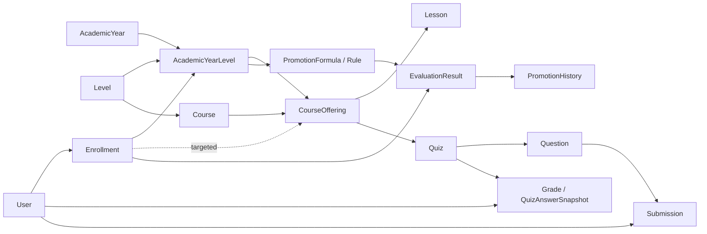

# Project memory - architecture and navigation map

Structural map of the current Django repository, reviewed 5 November 2026.
This answers **where a feature lives, what models mean, and what to reuse before
implementing**. Open the relevant owner and callers instead of rescanning the
whole app. Source remains authoritative when a map entry drifts.

Read [AGENTS.md](AGENTS.md) for mandatory rules, [CODING_GUIDE.md](CODING_GUIDE.md)
for the feature/bug workflow, [current handoff](IMPLEMENTATION_MEMORY.md) for
status and [active work](docs/current/README.md) for unimplemented tasks. Historical
session logs and old proposals are in [the archive](docs/archive/README.md).

## 1. Project boundaries

- Server-rendered Bible Institute LMS: Django 5.1 target, PostgreSQL authority,
  Bootstrap/Django templates, HTMX, Alpine and existing media/PDF integrations.
- Arabic/English and RTL/LTR; approved default is Arabic until explicit English
  per browser/device. Some current English fallbacks still need remediation.
- Target approximately 10,000 students, three ordered levels and hundreds of
  lessons/quizzes per year. Preserve bounded page/batch behavior.
- SQLite contains real migration-source data, not the production behavior
  reference. Never recreate it. Applied database state is not implied by this map.
- Celery/Redis provide existing quiz/media/gallery/delivery tasks. Cloudflare R2
  stores media/private artifacts; worker.js participates in protected playback.
- This checkout provides mobile APIs; native student/admin client UI is outside
  this server repository. prototype/admin-redesign is a standalone study, not
  deployed Django UI and not authority to redesign the app.

## 2. Directory map

| Path | Purpose / first place to inspect |
|---|---|
| [learning_platform](learning_platform) | Settings, root routing, middleware registration, Celery startup/routes/Beat, WSGI/ASGI. |
| [management_system/models.py](management_system/models.py) | All current model definitions; source catalog below. |
| [management_system/views.py](management_system/views.py) | Main web endpoints, forms orchestration, student/media/attendance/report adapters. Keep intact except approved domain extraction. |
| [management_system/urls.py](management_system/urls.py) | Main web route-to-handler map. |
| [management_system/student_experience_views.py](management_system/student_experience_views.py) | Admin-only per-student experience override POST adapter; uses `can_manage_academic_setup` and the existing User override field. |
| [management_system/forms.py](management_system/forms.py) | Signup/profile/content/academic forms and validation adapters. |
| [management_system/admin.py](management_system/admin.py) | Django-admin registration, role gates and list query behavior. |
| [management_system/academic_access.py](management_system/academic_access.py) | Read/write offering eligibility and canonical enrollment predicates. |
| [management_system/calendar_grid.py](management_system/calendar_grid.py) | Canonical month-grid day shape and event agenda shared by admin and student calendars. |
| [management_system/student_experience](management_system/student_experience) | Authenticated student mode resolver, new-shell adapter, bounded page contexts, profile builder and quiz presentation builder; reuses canonical student access/progress data. |
| [management_system/management/commands/student_experience_mode.py](management_system/management/commands/student_experience_mode.py) | Operator command for per-account override and global student UI rollout; the per-account admin control is on the Users detail page, while the global settings page remains unimplemented. |
| management_system/academic_*.py | Enrollment/decisions, copy, formula normalization and academic evaluation/promotion. See reuse map. |
| [management_system/utils](management_system/utils) | Validators, attendance/report/query/localization/storage helpers. The adjacent all-comment utils.py is not this active package. |
| [management_system/mobile_api.py](management_system/mobile_api.py) | Mobile endpoint adapters; mobile_urls.py maps their routes. |
| [management_system/telegram](management_system/telegram) | Telegram configuration/linking/policy/recipients/support/broadcast/delivery internals. |
| management_system/*_tasks.py; tasks.py | Specialized task entrypoints, retries/recovery and delivery. Domain logic stays in owning functions. |
| [management_system/templates](management_system/templates) | Full shells/pages, partials/components and preserved theme_showcase references. |
| [management_system/static](management_system/static) | Existing CSS system, JS/Alpine components/stores and vendored assets. |
| [management_system/migrations](management_system/migrations) | Historical schema/data transitions. Inspect current graph and DB applied state before adding a forward migration. |
| [management_system/management/commands](management_system/management/commands) | Academic/image audits, import/fixture/bootstrap commands. Not all old scripts are safe on real data. |
| [management_system/scripts](management_system/scripts) | Legacy manual utilities; caller/data-safety inspection required before use. |
| [locale](locale) | Arabic/English PO/MO catalogs; maintain translated messages and catalog consistency. |
| [worker.js](worker.js) | Cloudflare playback/public-resource/signature/receipt boundary. Keep public/ namespace and Django authorization distinct. |
| compose.*.yml; Dockerfile; [deploy](deploy); [nginx](nginx) | Local/deployment topology, queues, healthchecks, proxy/TLS/runtime includes. Never infer production status from config files. |
| [docs/current](docs/current) | Only active approved work and current release gates. |
| [docs/pending](docs/pending) | Preserved unfinished/unverified external-client/operator/UI plans; explicit status index. |
| [docs/reference](docs/reference) | Focused current-use contracts and source catalogs, consulted as needed. |
| [docs/archive](docs/archive) | Completed/superseded plans, old reports and full session history. Not startup instructions. |

## 3. Academic model meaning

The complete [model catalog](docs/reference/MODEL_MAP.md) covers all 62 current
model classes, declared fields, 127 relationships, enums and named constraints/
indexes without reading a database. Use it for exact field navigation; inspect
models.py clean/save/constraints and the domain owner before writing.

Arrows show ownership/reference direction, not permission by themselves.

| Model | Definition / important boundary |
|---|---|
| Role / User | Roles admin/staff/moderator/student are capability categories, not academic levels. User extends AbstractUser with application/identity/private-file/study-mode/timezone fields; CanonicalUserManager owns natural-key username normalization. |
| StudentExperienceSettings / User.student_experience_override | Global new/legacy default plus inherit/legacy/new per-account override. Only student-role accounts resolve to the new presentation. Migration 0118 seeds legacy. Global updates invalidate the short settings cache on transaction commit. |
| Level | Ordered reusable academic level with Arabic/English names; ordering is unique. |
| Course | Catalog item attached to Level; name+level unique. instructor is text, not a User FK. A catalog course is not a particular year's delivered content. |
| AcademicYear | Named/ordered date range; at most one active year; optional graduation level. Levels are a through relationship. |
| AcademicYearLevel | AcademicYear+Level scope, unique pair, with locked meeting weekdays. Most placement/calendar/formula/payment work is scoped here. |
| CourseOffering | Course delivered inside one AcademicYearLevel; owns publication state and content. Check catalog level matches scope; do not infer a year from Course alone. |
| Enrollment | User student + scope, with optional offering. Normal grants a full scope and requires no offering; repeat/remedial/manual target an offering. Status active/inactive/completed/withdrawn. Type/target and uniqueness constraints matter. |
| Lesson | Belongs to offering with draft/published/archived state; optional opening_date is the student release gate (null means available at publication); links is encoded text describing media entries/part IDs. Reuse current parsing/storage logic, not a new schema assumption. |
| Quiz / QuizType | Quiz belongs to offering, optional type, publication state, opening/closing windows, non-negative attempt duration (default 60 minutes, with no product cap) and total. QuizStudentOpening supplies a per-student exceptional window; publication_event_version invalidates stale future notification snapshots. |
| Question | Quiz question type/text/grade/answer/configuration and serializers/grading helpers. `quiz_questions.py` owns normalized validation for manual create/update and JSON import. Student-safe serialization must preserve answer secrecy. |
| Submission | User+question answer/grade/is_graded; question can become null. It is not a FK to Grade. Structured answers are represented through the existing payload helpers. |
| Grade | Final total per user+quiz, unique pair; do not create duplicate finals on retries. |
| QuizAnswerSnapshot | Unique quiz+user normalized answer snapshot/revision and immutable server-owned deadline for autosave/recovery; not the final grade. Deadline is min(start + quiz duration, effective student close). Attempt starts and exceptional-window changes serialize on Quiz; autosave, submit and reconciliation lock the per-student snapshot, and reconciliation locks due snapshots before reading answers. Historical snapshots are backfilled to their prior effective close because their start time is unknown. |
| QuizOperationJob | Existing durable quiz recalculation/reconciliation job, selection/cursor/counters/lease/status/language. Not a general admin-operation schema. |
| PromotionFormula / PromotionRule | Formula scoped to year-level, optional specific offering; weighted quiz/attendance rules, date window and thresholds. Shared validation/evaluation own mode applicability. |
| EvaluationResult | Formula+enrollment, optional offering for aggregate; computed versus final status/score, snapshots and override metadata. Course and aggregate uniqueness differ. |
| HistoricalAcademicSummary | Reviewed imported student+scope outcome when no LMS quiz history exists; source_key and student+scope uniqueness; review/progression metadata. |
| PromotionHistory | Protected immutable transition history with exactly one result or historical-summary source, source/destination enrollment/scope, actor and snapshots. Historical manual transitions need a reason. |
| AcademicPayment | Student+year-level receipt, unique pair; private receipt/preview keys. Not a generic billing/order system. |
| AcademicYearLevelMeeting / AcademicHoliday | Scope/date meeting points at an offering; holidays belong to an academic year. Calendar and attendance validity use scope weekdays/year bounds. |
| AttendancePolicy / AttendanceRecord | Central timing/classification policy; student/offering/date entrance/exit with scan/auto/manual source and correction metadata. Student progress exposes paired actual-scan days without score; authorized attendance/reporting views retain score and expose paired actual-scan count separately. Unassigned legacy rows can have no offering. |

### Supporting model domains

Use the model catalog for exact fields/relationships; these groups locate the
relevant records without creating another ORM layer:

- Playback: ViewingSession, LectureProgressEvent, VerifiedSegmentRequest,
  LectureProgress, LectureWatchSession, LectureWatchDay. Coverage/completion and
  active watch time are separate facts; do not replace one with the other.
- Applications/study mode: SignupSettings, OfflineCity, user application fields
  and MigrationReviewItem. Missing/ambiguous legacy mapping is reviewed, not guessed.
- Mobile identity/delivery: StudentMobileSession, MobileBiometricCredential,
  MobileOtpChallenge, MobilePushDevice and PushDelivery. Each push device stores
  its normalized language (Arabic by default); mobile registration carries the
  existing `Accept-Language` preference and push payloads select matching
  Arabic/English notification text.
- In-app/Telegram messages: Announcement, StudentNotification, TelegramBotConfig,
  TelegramAccount, TelegramLinkToken, TelegramWebhookUpdate,
  TelegramNotificationDelivery, TelegramConversation, TelegramMessage
(canonical per-inbound answered_by/answered_at/answer_reply, frozen
covered_message_ids, sending bot_config),
  TelegramAttachment (duration_seconds for audio), TelegramBroadcast, TelegramBroadcastAttachment,
  TelegramBroadcastRecipient.
- Durable admin operations: AdminOperationJob ledger for formula recalculation, promotion,
  historical intake, legacy CSV, exports, course copy, attendance reconcile and storage work;
  QuizOperationJob/media jobs remain canonical for their domains.
- Media/gallery/site: MediaProcessingJob, GraduationGalleryJob/Item,
  MobileAppRelease, MobileAppUpdatePolicy, MobileDownloadPolicy and StudentBanner.

## 4. Reuse before implementation

| Responsibility | Existing owner / useful entrypoints | Inspect with it |
|---|---|---|
| Roles/capabilities | [utils/decorators.py](management_system/utils/decorators.py): can_manage_*, can_view_reports, capability_required | View/admin/API/worker boundary and object relationship checks; role is not object authorization. |
| Offering access | [academic_access.py](management_system/academic_access.py): readable_offering_access, accessible_offerings, user_can_read_offering, user_can_write_offering_activity, get_accessible_offering_or_403 | Lists/detail/media/quiz/progress/recipients; readable active/completed history differs from active writable enrollment. |
| Count/navigation reads | [course_content.py](management_system/course_content.py): with_offering_content_counts, course_navigation | Already-authorized offering input; optional draft flags; card/sidebar fields. Helpers do not independently authorize arbitrary IDs. |
| Scheduled lesson access | [utils/lesson_access.py](management_system/utils/lesson_access.py): lesson_available_filter, lesson_is_available | Student lesson lists/details, protected media and progress, course counts/navigation, and Telegram lists/callbacks. Null opening means available now; published future lessons stay hidden and media/progress reads recheck the same gate. |
| Student response data | [utils/student_data.py](management_system/utils/student_data.py): student_courses_data, student_course_data, student_quiz_data, student_progress_data, student_next_actions | Web/mobile adapters, pagination, safe quiz payloads and optional sections. Do not build a read DTO just to execute a command. |
| Authenticated student UI rollout | [student_experience/mode.py](management_system/student_experience/mode.py), render.py, learning.py, course.py, lesson.py, calendar.py; [student_experience_views.py](management_system/student_experience_views.py); `user_profile` and `user_detail_content.html` | Existing student web handlers select the new shell only for student accounts in new mode. Access, quiz state, media and progress remain owned by their existing domain paths. Admins can set one student's inherit/legacy/new override through the dedicated Users detail card/POST endpoint (or the `student_experience_mode` command); the global setting remains separate. The admin workspace remains in its normal shell. |
| Management student overview | [student_overview.py](management_system/student_overview.py): build_student_overview | Profile/overview templates, current access labels and count helper. |
| Application/enrollment transitions | [academic_enrollment.py](management_system/academic_enrollment.py): set_application_status, bulk_set_application_status, set_user_normal_enrollment_scope, activate_academic_year | Locks, forms, application review/bulk callers, payments and delivery callbacks. |
| Historical intake/promotion | [historical_intake.py](management_system/historical_intake.py), academic_enrollment.py: promote_historical_summary/promote_evaluation_result(s), is_last_academic_level | Preview/apply normalization, source_key idempotency, destination scope, failed-course access and immutable histories. One canonical find/create action plan and one last-level rule are shared by preview and apply. Uploaded intake rows are validated in bounded pages and applied per row by the `HISTORICAL_INTAKE` job executor. |
| Legacy user CSV | [legacy_user_import.py](management_system/legacy_user_import.py): validate_legacy_import_rows, enqueue_legacy_user_import, execute_legacy_user_import | Whole-file all-or-nothing import on the J01 ledger; bounded private artifact, pre-enqueue validation without hashing, then hashing/apply on the admin worker. Deliberately separate from historical intake and its per-row contract. |
| Formula/evaluation | [academic_formula.py](management_system/academic_formula.py): normalize/validate/save; [academic_evaluation.py](management_system/academic_evaluation.py): build_evaluation_plan, evaluation_enrollments, evaluate_enrollment_page, save_formula_and_enqueue, execute_formula_recalculation | Preview/pagination/save/export/promotion; overrides and mode weights. Saving queues a scope-wide J01 recalculation with token-fenced per-batch commits; retry preserves actual timestamped overrides only. Scope locking excludes override writes during active calculation; promotion is blocked while the latest calculation is incomplete. |
| Content copying | [academic_copy.py](management_system/academic_copy.py): copy_offerings, duplicate_offering, execute_course_copy | duplicate_course/lesson/quiz adapters, source offering, content flags, draft state and transaction contract. Full offering/scope copies run as `COURSE_COPY` jobs with one all-or-nothing unit; one lesson/quiz duplicate stays direct, and course duplication requires an explicit source offering. |
| Quiz questions/import | [quiz_questions.py](management_system/quiz_questions.py), [quiz_import.py](management_system/quiz_import.py) | Manual create/update, JSON import/manual, bulk write validation and input limits. Existing builder is not proof A18/A19 are fixed. |
| Quiz attempts/grading | [quiz_attempts.py](management_system/quiz_attempts.py): start_quiz_attempt, normalize_answers, save_snapshot, submit_answers, reconcile_snapshots; [quiz_grading.py](management_system/quiz_grading.py) | Web/mobile explicit start, snapshot and submit, timer and recovery task; [utils/quiz_access.py](management_system/utils/quiz_access.py) owns status, effective windows, exceptional openings and answer release. Question initialization is inside the window; one server deadline is clamped to the effective close and governs reads, autosave, submit and recovery. Start, autosave, submit and reconciliation serialize on the quiz row; recovery also locks due snapshots and scans through the deadline index. |
| Attendance/calendar | [utils/attendance.py](management_system/utils/attendance.py): grade_attendance_day, fully_scanned_attendance_day, pair/merge_attendance_pairs, attendance_scores_for_students, reconcile_missing_exits, get_expected_dates | Student progress uses only paired actual entrance/exit scans regardless of timing; authorized attendance_matrix.py, utils/reports.py and report exports keep score separate from that count. Calendar/scan/correction views and attendance_tasks.py keep existing grading/reconciliation rules. Missing-exit reconciliation is idempotent keyset batches; manual population runs use the `ATTENDANCE_RECONCILE` job while the scheduled task keeps calling the same operation. |
| Reports/matrices | [utils/reports.py](management_system/utils/reports.py): report_enrollments, load_report_facts, iter_report_batches, build_report_page_rows, iter_report_data; grade_matrix.py/attendance_matrix.py/payment_matrix.py; report_export.py three-sheet workbook; evaluation_export.py saved-result export | HTML/CSV/XLSX and evaluation job/artifact; shared facts/rounding/filter semantics, bounded output and xlsx_export.py row rollover. |
| Private uploads/replacement | [utils/application_uploads.py](management_system/utils/application_uploads.py), utils/storage_operations.py | Signup, profile, UpdateUser, application_review, missing-document and payment-receipt writes reserve `applications/<user_id>` before taking user/payment row locks; document references swap transactionally and replaced objects clean up after commit. Generic storage rename/delete must use the same path-lock-before-row-update order. |
| Media/storage ownership | [media_storage.py](management_system/media_storage.py), [storage_ownership.py](management_system/storage_ownership.py), [storage_coordination.py](management_system/storage_coordination.py), [storage_clients.py](management_system/storage_clients.py), utils/r2_references.py, utils/r2_manager.py, storage_jobs.py | `storage_ownership`: one key/prefix rule for generic R2 list/search/sign/move/rename/delete (private `applications/` stays admin-only and transitions remain within the same owner); `storage_coordination` uses shared ancestor/exclusive exact-path transaction locks for direct writes and durable storage/media/gallery reservations, plus a separate active-job-cap lock. Folder rename and recursive delete run as bounded STORAGE_RENAME/STORAGE_DELETE jobs with committed cursors; rename updates lesson, application/payment, gallery, app-release and active viewing references, and delete keeps referenced objects. Gallery upload authorization reserves its staging/output namespaces before creating a job. Incomplete rename restores originals before retaining old references. STORAGE_USAGE_REFRESH owns provider statistics work; dashboard/API GET reads timestamped shared job snapshots and filters private samples, while CSRF POST queues refresh. `storage_clients.py` centralizes provider client construction. Media storage stays exact-key. |
| Media conversion | [media_processing.py](management_system/media_processing.py), media_tasks.py, automation_api.py | MediaProcessingJob, browser media job routes, private staging, FFmpeg queue/recovery and automation contract. One video job runs its audio deliverables on a sibling thread beside the video encode (uploads stay sequential in the main thread); the dedicated worker runs `MEDIA_WORKER_CONCURRENCY` jobs and sizes each encoder to the container CPU quota. `worker_id` records the claiming worker instance; the SIGTERM hook releases that worker's jobs to `queued`, the worker-ready recovery pass re-dispatches them, and a missing Redis liveness mark resumes a crashed worker's jobs. `interrupted_count` keeps deploy/crash releases out of `MAX_MEDIA_ATTEMPTS`. |
| Notification facts and withdrawal | [student_notifications.py](management_system/student_notifications.py), [notification_withdrawal.py](management_system/notification_withdrawal.py), announcements.py, [mobile_push.py](management_system/mobile_push.py), [mobile_push_queries.py](management_system/mobile_push_queries.py), [utils/timezones.py](management_system/utils/timezones.py) | Channel-specific task delivery; academic dates use `DD-MM-YYYY (HH:MM) (Day)` in the user's display timezone. Quiz/lesson titles identify course and item; push bodies put availability/deadline and action first. Push language is stored per MobilePushDevice from normalized Accept-Language; Arabic is the default and push text follows the explicit device language. Withdrawal is an admin action on the saved StudentNotification; it hides the inbox item, skips queued channels and attempts Telegram deletion. Telegram retry/recovery locks StudentNotification before its delivery row so withdrawal cannot be followed by a stale requeue. Expo pushes already accepted by providers are recalled by the mobile client through `mobile_notifications.py` when it next syncs. Push materialization, claim, pre-send and retry paths all recheck withdrawn/cancelled state. |
| Telegram | [telegram/recipients.py](management_system/telegram/recipients.py), policy.py, linking.py, [support.py](management_system/telegram/support.py), [deletion.py](management_system/telegram/deletion.py), [broadcasts.py](management_system/telegram/broadcasts.py), notifications.py | telegram_views.py/forms/tasks; configuration, attachments/media and independent webhook/delivery trust boundaries. Support claims/replies serialize on the conversation; inbound and outbound rows retain exact source/sender, current resolver and shared read marker. Interrupted support replies become `UNKNOWN` and a bounded Celery recovery task reopens only the matching stale claim; they are never resent automatically. Failed support digests remain visible in the LMS but do not have a retry action. Telegram deletion is limited to recorded private messages and the provider's 48-hour window; outbound rows do not retain bot identity, so deletion uses the active bot and can fail after switching to a different bot. Broadcasts retain each text/attachment message ID. See [TELEGRAM_SUPPORT_LIFECYCLE.md](docs/current/TELEGRAM_SUPPORT_LIFECYCLE.md) for transitions, multi-admin rules and withdrawal limits. |
| Input identity | [utils/validators.py](management_system/utils/validators.py), [managers.py](management_system/managers.py) | Signup/profile/admin forms, canonical usernames, phone/identity normalization and unique constraints. |
| Study mode/payment | [study_mode.py](management_system/study_mode.py), [payments.py](management_system/payments.py) | OfflineCity/user override, AcademicPayment and attendance/evaluation eligibility. |
| Management selections | [admin_tables.py](management_system/admin_tables.py): scope_queryset, create/load_selection_token | Signed actor/view/filter/exclusions, strict boolean parsing and delete endpoints; the loader owns view/actor binding. Durable quiz selections consume the same contract. Scope builders (`user_scope`, `course_scope`, `content_scope`) and their querysets are extended together with counts (`user_tab_counts`, `content_status_counts`), sorting, signed selection and exports. |
| Admin workspace navigation and Today | [admin_navigation.py](management_system/admin_navigation.py), [admin_today.py](management_system/admin_today.py), [templatetags/aw_ui.py](management_system/templatetags/aw_ui.py) | The only rail/sidebar/top-bar/quick-create model (capability-filtered, URL names plus route aliases, no queries, no role strings in templates); `aw_admin_workspace`/`aw_capabilities` tags; bounded actor/ownership-scoped Today queues with one count and one <=5-row sample each, plus upcoming meetings/holidays. Admin page navigation refreshes the persistent rail, sidebar, mobile nav and crumb through `hx-select-oob` regions rendered by `render_page()`. |
| Durable management jobs | [admin_operations.py](management_system/admin_operations.py), admin_operation_tasks.py, admin_operation_views.py | AdminOperationJob ledger: savepoint-safe creation with frozen-input equivalence, fresh active actor/capability checks, lease claim/takeover and task heartbeat, token-fenced progress/terminal commits, owner-bound status with shared calculation visibility, bounded private input/export artifacts (XLSX/CSV) with TTL cleanup and owner/admin streaming download, and the dedicated `admin` queue. Views enqueue named tasks through `enqueue_admin_operation` without importing the executor module. Operation executors stay in their owning domain modules. |
| Background jobs and notification history | [job_monitor.py](management_system/job_monitor.py), [job_monitor_views.py](management_system/job_monitor_views.py), [notification_history.py](management_system/notification_history.py), background_jobs.html and backgroundJobsMonitor.js | Admin-only SQL-paged history for management, quiz, media, gallery, announcement and confirmed Telegram batches, plus per-recipient StudentNotification inbox/push/Telegram attempts and withdrawal actor/outcomes. The notification-history route lists **one row per message**: `notification_history_groups()` groups by `NOTIFICATION_GROUP_FIELDS` (the same tuple `original_audience()` targets via `notification_message_identity()`), and each row opens the message's recipients in the shared peek drawer from the bounded `notification-group-recipients` fragment (drawer body, `?fragment=list` for search, `?fragment=more&page=N` appended by the `[data-aw-load-more]` scroll sentinel in admin_shell.js; 25/page, `?search=` within the message). The jobs route keeps the flat table. Withdrawn notifications have their own terminal history status. Poll only visible IDs in bounded batches; shared pause/resume preference; explicit server-localized toggle labels. Saved Arabic/English content and exact Telegram snapshots are shown without provider credentials/IDs. |
| Notification retry/redelivery | [notification_redelivery.py](management_system/notification_redelivery.py), student_notifications.py, mobile_push.py, telegram/notifications.py and telegram/broadcasts.py | AdminOperationJob-backed failed-only or resend-all copies; freeze the original audience, serialize overlapping event retries, and share bounded StudentNotification row locks with normal channel materializers so resend-all cannot race initial fan-out. Recheck actor/source/recipient eligibility at dispatch and preserve original attempts. Failed-only retries latest failed channel attempts without an inbox copy; resend-all makes a new visible inbox copy. Expo receipt and Telegram outcomes determine completion. Broadcast retries point to the original root and compare latest recipient outcomes. Missing historical Telegram text snapshots are rebuilt through the normal channel formatter; existing provider workers and inbox materialization remain the delivery owners. |
| Notification withdrawal | [notification_withdrawal.py](management_system/notification_withdrawal.py), notification_views.py (`notification-withdraw`, `notification-group-withdraw`) | `withdraw_student_notification` is the one per-recipient rule (hide the inbox row, cancel queued push/Telegram, delete the bot copy inside the 48-hour window, report push recall). A whole message is withdrawn by the `NOTIFICATION_WITHDRAWAL` AdminOperationJob: `execute_notification_withdrawal` walks the message identity in pk batches, calls that same rule per recipient, commits progress/cursor and reports partial failures. Mobile clients dismiss an already-delivered push when they next sync; provider deletion is never retried automatically. |
| Web page/fragment adapter | [utils/helpers.py](management_system/utils/helpers.py): render_page, hx_target_id, paginate_obj, render_dashboard | Base/admin/course shells, partial roots, message toasts, context_processors.py and HTMX callers. |

For complete function/class navigation consult [MODULE_MAP.md](docs/reference/MODULE_MAP.md).
It is an index of source declarations, not a guarantee each legacy helper is
approved or efficient. Prefer the owners above; inspect callers before reuse.

## 5. Feature entrypoints and flow

| Work | Start here | Then follow |
|---|---|---|
| Public/signup/login/profile | views.py, forms.py, urls.py; password_reset.py; public_content.py | SignupSettings/User, application transitions/private uploads, login/base/public templates. |
| Academic management/promotion | views.py promotion_formula/bulk_promotion_results/calendar handlers | academic_* domain modules, scope forms/templates, saved result/export consumers; bulk promotion preloads PromotionFacts per chunk and keeps per-student locks. |
| Student course/quiz | views.py course/lesson/take_exam/quiz_start handlers; utils/student_data.py | academic_access -> content/attempt operation -> course_detail/display_quiz/questions partials; mobile readers share data/domain functions. Upcoming quiz pages are metadata-only until explicit start, and scheduled lessons are omitted until available. |
| Mobile API | learning_platform/urls.py -> mobile_urls.py -> mobile_api.py; notification withdrawal is in mobile_notifications.py | mobile_auth.py, mobile_http.py, mobile_otp.py/tasks, mobile_versioning.py, mobile_downloads.py, localization helper. Notification withdrawal lookups accept only bounded, authenticated IDs owned by the current mobile account. |
| Protected playback/progress | views.py start_viewing_session/lesson_manifest/progress_heartbeat; mobile_api.py media/progress endpoints; worker.js | media_delivery.py owns media link/session/token/manifest/audio/book resolution; progress_activity.apply_progress_heartbeat owns merged progress/events; web and mobile keep their own transport auth/HTTP formatting. |
| Media management/automation | views.py media_job_*; automation_urls.py/automation_api.py | media_processing/storage/tasks and MediaProcessingJob; client reference manual. `_media_job_ui_state`/`_serialize_media_job` expose the persisted row (status, phase, percent, outputs, attachment, staging, cleanup) and apply the Redis progress hash only for the current attempt of an active job; the drawer renders that same state with the row's can_* action gates. |
| Attendance | views.py scanner/scan_preview/record_attendance/correction | capability, token, meeting scope, utils.attendance, policy and schedule. The scanner page posts `/scan/<token>/<action>/` with fetch while the camera keeps running: entrance is the default mode, an exit toggle arms exit for one scan then resets, and the JSON answer carries the resolved student and course for the in-page banner. A decoded code is cached client-side for five seconds; the server still owns duplicate rejection. |
| Reporting/exports | views.py export_* / report dashboard | utils.reports, report_export.py, xlsx_export.py and matrix modules; whole-scope evaluation and report workbook exports run on the J01 ledger with owner/admin private-artifact downloads, while CSV stays a bounded streaming response. |
| Announcements/Telegram/push | notification_views.py, telegram_views.py; gallery_views.py for gallery | student_notifications.py and announcement fan-out; notification_history.py for saved per-recipient content/outcomes; notification_redelivery.py for admin retry/resend ledger work; telegram/broadcasts.py and channel-specific provider tasks. Recheck source/recipient eligibility at enqueue and delayed provider boundaries. |
| App releases/banners | portal_views.py | MobileAppRelease/UpdatePolicy/DownloadPolicy/StudentBanner, portal templates, API version/download response contracts. |

Root routes in [learning_platform/urls.py](learning_platform/urls.py): localized
web routes include management_system.urls; /admin/ is Django admin;
/api/mobile/v1/ is mobile; /api/automation/ is automation; Telegram webhook and
i18n are separate. The JavaScript catalogue (`/jsi18n/`) sits inside the
localized patterns so `` yields `/ar/jsi18n/` or
`/en/jsi18n/` and browser `gettext()` follows the page language. Consult actual
route modules for exact names/payloads.

## 6. Frontend locations and contracts

- Shell/page/partial ownership lives under templates. admin_panel.html owns the
  single admin workspace shell (`.aw-shell`: domain rail, contextual sidebar,
  sticky top bar, off-canvas mobile navigation, one peek drawer) and the default
  Today cockpit include; course_detail.html owns the learning shell and lesson
  destination; display_quiz.html/questions_rendering.html own the student exam.
  Keep the authoring quiz_form.html/quizForm.js workflow separate.
- Legacy and new student exams share `templates/partials/quiz_runtime.html`
  and `static/js/student_experience/quiz_runtime.js` for snapshot persistence,
  structured-answer serialization/restoration and the server-deadline timer.
  `static/js/student_next/quiz.js` owns only the new-mode question navigator.
- The authenticated new student shell lives under `templates/student_next/`
  and owns only `sn-*` markup, `static/css/student_next.css`, and
  `static/js/student_next/`. CSS selectors are rooted under `body.sn-student`
  or `html.sn-html`; the shell does not load Bootstrap, Font Awesome, or the
  legacy student shell assets. Arabic labels and plural forms live in the
  standard `locale/ar/LC_MESSAGES/django.po` catalog. Existing student routes
  keep their legacy templates as the default until the per-account or global
  mode is changed.
- Admin static CSS: `static/css/admin_workspace.css` loads last on admin pages
  only and owns the `aw-*` tokens/components under the `body.aw-admin` theme
  owner (including overlays); `app_admin.css` keeps the legacy `ad-*` layer for
  pages not yet converted. Shared `aw_*` partials provide avatar, status pill,
  page head, filter bar, empty state and the icon sprite. `.aw-workspace`
  (a.k.a. `#display-page`) fills the main column (`flex: 1 1 auto`), so a short
  page owns the area below its content instead of leaving a bare canvas band;
  pages that set their own height (the chat workspace) keep it.
- A clipped/scrollable region must also be a containing block: `.aw-table-wrap`
  and `.aw-matrix-wrap` are `position: relative` because the shared
  `.visually-hidden` helper is `position: absolute`, and an absolute box is not
  clipped by an ancestor outside its containing-block chain - without it the
  hidden per-row labels extend the document scroll height by the clipped table
  height (empty space that grows with every row). Any new scroll region that can
  contain absolute descendants needs the same treatment.
- Modal scroll lock: a drawer/overlay must not hide the page overflow in place,
  because that removes the scrollport the sticky rail/sidebar pin to and leaves
  them at the old offset above the viewport. `admin_shell.js` pins the page to the
  top (`html.aw-scroll-locked`, gutter released) while the drawer covers it and
  restores `scrollY` on close. Reuse that lock for any new full-height overlay
  instead of adding `body { overflow: hidden }`.
- Static cache-busting: every page emits `?v={{ static_asset_version }}` and
  nginx marks any non-empty `v` immutable for 7 days, so
  `settings.STATIC_ASSET_VERSION` must change when an asset changes (it derives
  from the newest owned css/js modification time unless a release pipeline sets
  the env var). Never pin it to a constant.
- Telegram chat workspace:
  `partials/telegram_chat_layout.html` owns the conversations column plus the
  chat panel for **both** the inbox and one-conversation pages;
  `partials/telegram_chat_panel.html` owns the panel root
  (`#telegram-chat-panel`, `is-open`/`is-empty`) and is swapped whole
  (`hx-select` + `hx-swap="outerHTML"`). The list column is a page sibling of
  the panel, never inside it. `admin_workspace.css` section 20 owns the
  three-column/scroll contract and `admin_shell.js` re-initialises Alpine on the
  swapped panel. Its width queries are declared after the base chat rules
  (they set `display`); below 1180px the student rail is hidden and below 900px
  the workspace is one pane at a time with the phone-only `.aw-chat-back`
  control. Viewport-height pages size themselves with `--aw-chat-offset`
  (top bar + workspace padding), re-declared at the 991.98 and 720 breakpoints
  together with the workspace padding. One bubble reads
  `.aw-msg-head` -> `.aw-msg-text` -> `.aw-msg-time` -> `.aw-msg-flags` ->
  `.aw-msg-actions`; keep that order for every delivery/alert state instead of
  adding a second metadata line.
- Static CSS: app.css, app_admin.css, app_student.css, psalmodia.css,
  public_site.css and reference design styles. Repeated layers are intentional
  unless an exact stale override is proved; no mass cascade consolidation.
- Alpine stores/components under static/js/alpine; admin_shell.js registers the
  management components, the top-bar menu controller and the drawer lifecycle.
  HTMX navigation can need components loaded before a destination exists. Do not
  strip all global scripts as unused.
- Shared partials/components hold table/pagination/filter/form/toast primitives.
  The table shell supports an optional `row_template` for domain rows (Students
  first) while keeping `.ad-table-shell`/`.ad-table`/`#table-container` hooks.
  Match root IDs, targets, swap behavior, Alpine teardown and bound errors before
  extracting a common component. Do not invent a new generic frontend loader.
- Keep stable media part IDs, form field names and public static URLs unless
  the approved task updates all consumers. Vendor assets are not first-party
  cleanup candidates. Prototype source/builders remain separate references.

## 7. Runtime boundaries

This map describes current owners and contracts; release state belongs in the
[implementation handoff](IMPLEMENTATION_MEMORY.md), approved
[remediation checklist](docs/current/REMEDIATION_CHECKLIST.md) and
[completion report](docs/current/REMEDIATION_COMPLETION_REPORT.md).

- `AdminOperationJob` owns durable management operations and notification
  redelivery. Quiz, media, gallery and channel-delivery jobs remain specialized
  owners; do not add a second path for a domain that already has one.
- Population-sized changes use the owning durable job. Preserve each operation's
  established transaction, partial-progress and recovery contract.
- `utils/localization.py`, `middleware.py` and `utils/client_identity.py` own the
  Arabic default/explicit English, session renewal and trusted client identity
  rules. Do not add request-local copies of those policies.
- Academic access, formula/promotion, question validation, signed selections
  and private storage ownership each have a shared owner listed above. Route
  every related caller through that owner.
- Storage writers and generic R2 rename/delete acquire the shared path lock
  before database row locks, and hold the namespace reservation through the
  object write plus reference commit. Keep gallery staging/public and APK
  release writes on the same coordinated path; avoid global locks on unrelated
  objects.
- Application unit-test modules were removed under the approved policy. Use the
  retained audit, browser, PostgreSQL and worker checks documented in the
  checklist and current handoff; a removed test is not verification.

## 8. Maintaining this map

Update the affected section in place when a model/relationship, domain owner,
public API/route family, shared operation or structural dependency changes.
Regenerate/review model/module reference catalogs after corresponding structural
changes. Remove stale entries when old paths disappear.

Do not append session logs, button-level changes, color changes, test results,
transient deployment state or an endless "new updates" list here. Put current
execution evidence/blockers in the compact handoff and completed history in the
archive. A new button only belongs in this map if it introduces a new workflow,
API boundary or reusable owner that agents need to locate.
